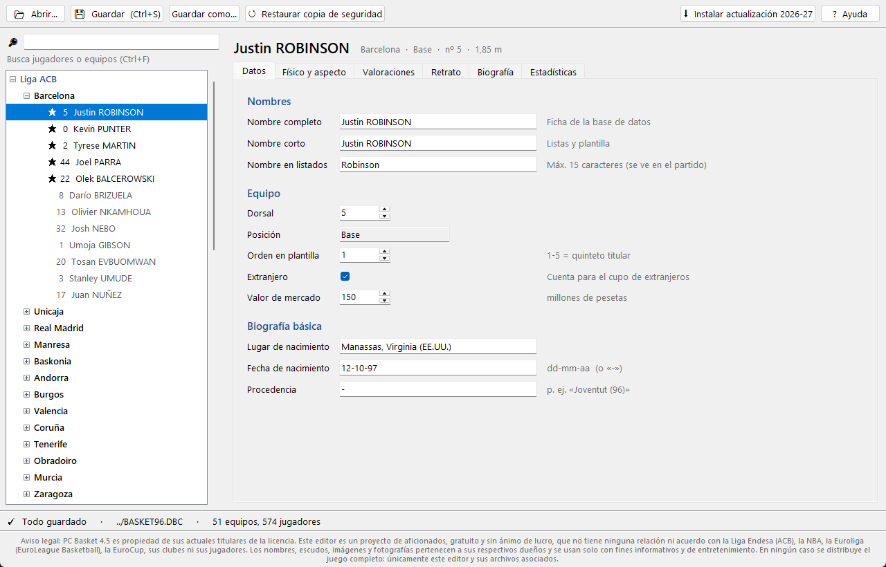

# Editor PC Basket 4.5 · Temporada 2026-27

Editor de equipos y jugadores para **PC Basket 4.5** (Dinamic, 1996), con una actualización que pone en el juego las plantillas reales de la temporada **2026-27**:

- **Liga Endesa:** los 18 equipos, con sus jugadores, retratos, escudos, equipaciones y nombres en el marcador.
- **Europa:** los 16 clubes no españoles de la Euroliga y 16 de la EuroCup.
- **All-Star:** Selección USA contra Selección Europea, con estrellas actuales de la NBA.
- **Euroliga del modo mánager:** con los participantes reales.

> **Necesitas tu propia copia de PC Basket 4.5.** Aquí no se distribuye el juego, solo el editor y un parche con las diferencias respecto a los archivos originales.

## Instalación rápida

1. Ve a [**Releases**](https://github.com/bodickerdev/pcbasketeditor/releases/latest) y descarga `EditorPCBasket_2026-27.zip`.
2. Descomprímelo donde quieras y abre `EditorPCBasket.exe`.
3. El editor te ofrece instalar la actualización (o pulsa **⬇ Instalar actualización 2026-27**). Acepta y elige la carpeta del juego, la que contiene `BASKET45.EXE`.
4. En el juego, empieza una **liga nueva**.

Los originales se guardan como `.BAK` y el botón **Restaurar copia de seguridad** deja el juego como estaba. Los detalles y la solución de problemas están en la [guía de instalación](docs/instalacion.md).

## Documentación

| | |
|---|---|
| [Instalación](docs/instalacion.md) | Instalar, desinstalar, DOSBox y problemas frecuentes |
| [Guía del editor](docs/guia-del-editor.md) | Cómo cambiar jugadores, equipos, retratos, escudos y equipaciones |
| [Temporada 2026-27](docs/temporada-2026-27.md) | Qué incluye la actualización y cómo se calcularon las valoraciones |
| [Preguntas frecuentes](docs/preguntas-frecuentes.md) | Dudas habituales |
| [Desarrollo](docs/desarrollo.md) | Estructura del código, formato del parche y cómo publicar una versión |
| [Formato de los archivos](FORMATO_DBC.md) | Descripción técnica de los archivos del juego |
| [Scripts de plantillas](plantillas/LEEME.md) | Cómo se descargan y aplican las plantillas reales |

## Licencia

El código del editor y de los scripts se publica con la [licencia MIT](LICENSE).

La licencia **no** cubre el juego, sus archivos ni los datos derivados de él. Tampoco cubre los nombres, escudos, fotografías y demás material de terceros incluido en las plantillas, que pertenecen a sus respectivos dueños.

## Aviso legal

PC Basket 4.5 es propiedad de sus actuales titulares de la licencia. Este editor es un proyecto de aficionados, gratuito y sin ánimo de lucro, que no tiene ninguna relación ni acuerdo con la Liga Endesa (ACB), la NBA, la Euroliga (EuroLeague Basketball), la EuroCup, sus clubes ni sus jugadores. Los nombres, escudos, imágenes y fotografías pertenecen a sus respectivos dueños y se usan solo con fines informativos y de entretenimiento. En ningún caso se distribuye el juego completo: únicamente este editor y sus archivos asociados.
