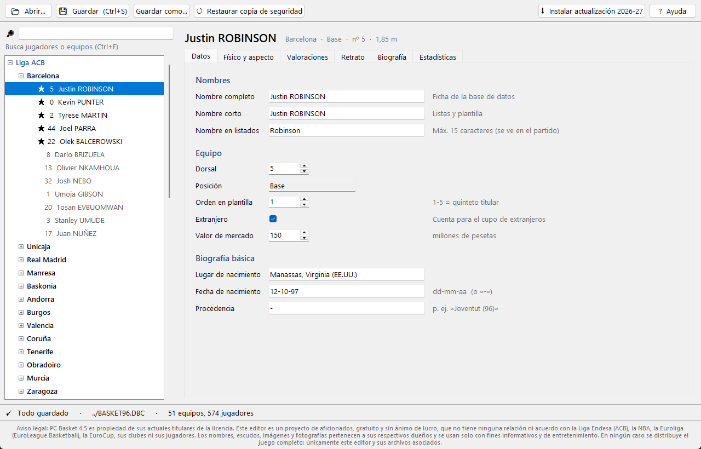
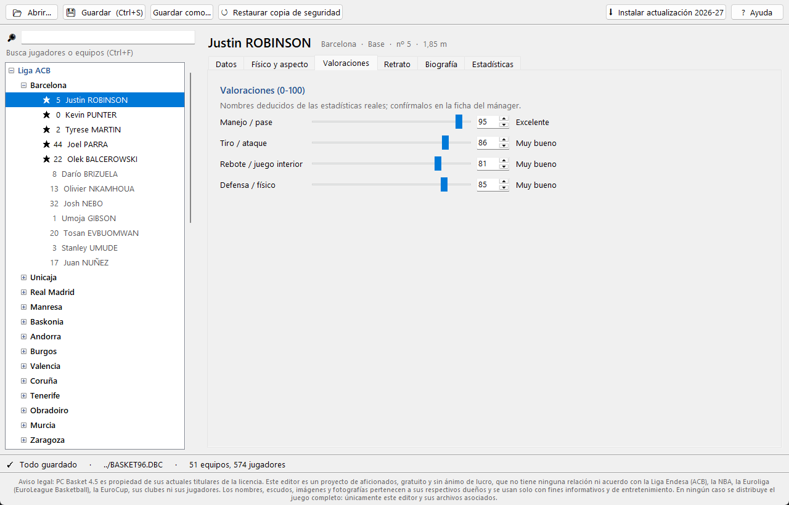
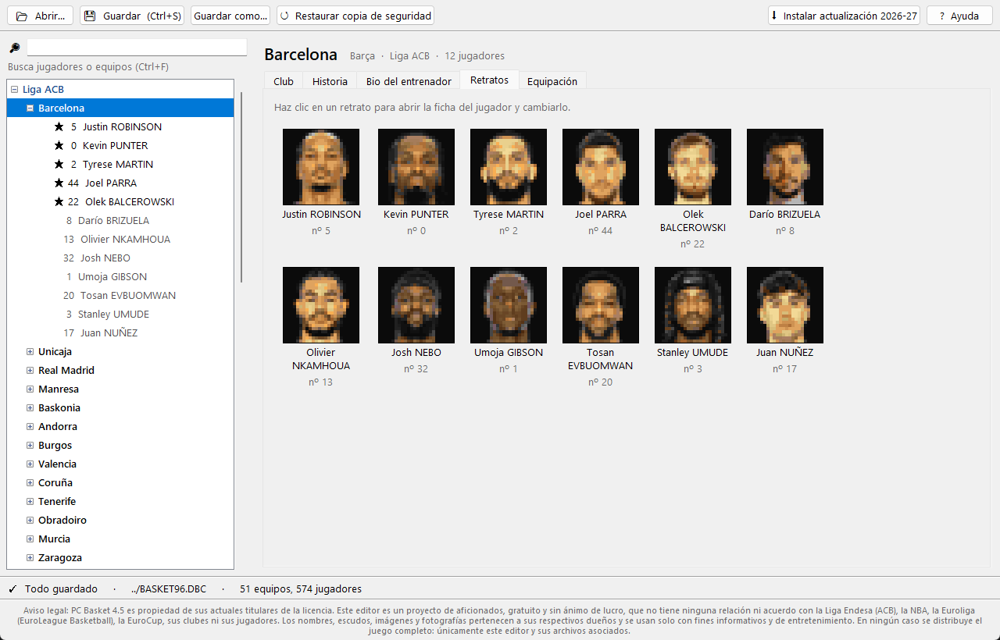
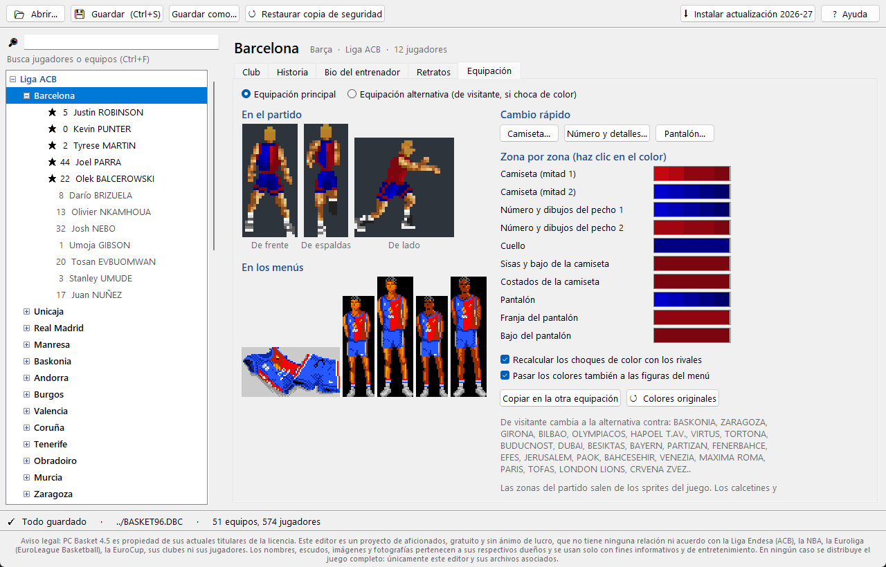

# Guía del editor

[← Volver al inicio](../README.md)

El editor sirve para cambiar cualquier equipo o jugador del juego, no solo para instalar la actualización 2026-27.

## La ventana principal

- **Barra superior:**
  - **Abrir…** carga otro `BASKET96.DBC`.
  - **Guardar** (Ctrl+S) escribe los cambios.
  - **Guardar como…** crea una copia de la base de datos.
  - **Restaurar copia de seguridad** vuelve a los originales.
  - **Instalar actualización 2026-27** instala el parche.
  - **Ayuda** muestra un resumen de uso.
- **Lista de la izquierda:** muestra los equipos agrupados en *Liga ACB*, *Europa* y *All-Star*. Despliega un equipo para ver sus jugadores. La ★ marca el quinteto titular.
- **Buscador** (Ctrl+F): escribe parte del nombre de un jugador o equipo.
- **Panel de la derecha:** la ficha de lo que hayas elegido.
- **Barra de estado:** indica si hay cambios sin guardar y qué archivo está abierto.

Los cambios se aplican al momento en la ficha, pero no llegan al juego hasta que pulsas **Guardar**. Un campo en **rojo** tiene un valor no válido y no se guarda.

> La primera vez que guardas, se crea `BASKET96.DBC.BAK` con el original. Haz siempre las pruebas en una **liga nueva**.

## Ficha del jugador

### Datos

| Campo | Notas |
|---|---|
| Nombre completo | Aparece en la ficha de la base de datos |
| Nombre corto | Aparece en las listas y la plantilla |
| Nombre en listados | Máximo 15 caracteres; es el que se ve durante el partido |
| Dorsal | De 0 a 99 |
| Posición | Base, escolta, alero, ala-pívot o pívot |
| Orden en plantilla | Del 1 al 5 forman el quinteto titular |
| Extranjero | Cuenta para el cupo de extranjeros |
| Valor de mercado | En millones de pesetas, como en el juego original |
| Lugar y fecha de nacimiento, procedencia | Texto de la ficha. La fecha usa el formato `dd-mm-aa` |

### Físico y aspecto

Altura, peso y el aspecto del jugador en el partido: color de piel, pelo, color de pelo y barba.

### Valoraciones

Hay cuatro valoraciones de 0 a 100. Son las que usa el juego para simular y para la ficha del mánager:

| Valoración | Qué mide |
|---|---|
| Manejo / pase | Asistencias y triples. Es la que más depende de la posición: alta en bases y baja en pívots |
| Tiro / ataque | Puntos y acierto en el tiro |
| Rebote / juego interior | Sobre todo la calidad general del jugador, con algo de rebote |
| Defensa / físico | Sobre todo la calidad general del jugador, con algo de robos, tapones y altura |

Los nombres se dedujeron comparando las valoraciones de 1996 con las estadísticas reales de aquellos jugadores. Como referencia: 90 o más es excelente, 80 muy bueno, 70 bueno y 60 normal.

### Retrato

Es la cara de 24×24 píxeles que aparece en el marcador cuando el jugador anota.

1. Pulsa **📷 Importar imagen…** y elige una foto (PNG, JPG, BMP, GIF o WEBP).
2. Arrastra el recuadro hasta la cara y ajusta el tamaño con la rueda del ratón. Lo mejor es encuadrar de la barbilla a la frente.
3. Pulsa **✔ Usar este retrato**. La imagen se reduce a la paleta de colores del juego.

Otros botones de esta pestaña:
- **Exportar como PNG** guarda el retrato ampliado ×4.
- **Quitar foto** deja el retrato en negro.
- **Deshacer cambios** recupera la imagen anterior.

Los jugadores europeos y del All-Star no tienen retrato en el marcador. En su lugar se edita la **cara de la pantalla previa al partido**, que es de 16 colores. Al guardar, el editor también copia los retratos de la ACB a esa pantalla.

### Biografía

Es el texto libre de la ficha. Las líneas deben tener unos 72 caracteres; el botón **Reajustar líneas** las corta solo.

### Estadísticas

Muestra la trayectoria temporada a temporada, en liga regular o play-off. Haz **doble clic** en una cifra para editarla.

> La temporada actual también la usa el simulador del mánager. Un jugador con todo a cero rendirá muy poco.

## Ficha del equipo

### Club

- **Nombre en menús:** puedes cambiarlo también en la ficha de todos sus jugadores.
- **Datos del club:** nombre largo, nombre oficial, pabellón, aforo, dirección, presidente, patrocinador y presupuesto.
- **Entrenador:** nombre completo y nombre corto.

### Historia y Bio del entrenador

Son textos libres que se ven en la base de datos del juego.

### Retratos y Escudo

- **Equipos de la ACB:** la pestaña muestra la plantilla con sus retratos. Haz clic en uno para ir a la ficha del jugador.
- **Equipos europeos y All-Star:** la pestaña se llama **Escudo** y sirve para cambiar el escudo del marcador.

### Equipación

- **Principal / alternativa:** la alternativa es la que usa el equipo de visitante cuando su color choca con el del rival.
- **Vista previa:** muestra el jugador en el partido (de frente, de espaldas y de lado) y las figuras de los menús.
- **Cambio rápido:** cambia de una vez el color de la camiseta, del número y detalles o del pantalón.
- **Zona por zona:** haz clic en cada franja de color para elegir su tono.
- **Recalcular los choques de color:** actualiza contra qué rivales se pone la alternativa. La lista aparece debajo.
- **Pasar los colores a las figuras del menú:** pinta también las figuras de los menús.
- **Copiar en la otra equipación** y **Colores originales:** atajos para copiar la equipación o deshacer los cambios.

Los calcetines y las zapatillas no se pueden cambiar. La vista previa es aproximada, así que comprueba el resultado en el juego.

## Logros

El botón **🏆 Logros** abre la lista de logros del modo mánager, con los superados (y su fecha) y los pendientes. Cuando consigues uno, sale un aviso arriba a la izquierda de la pantalla con el nombre del logro y la palabra **SUPERADO**.

- **Cuándo se comprueban:** mientras el editor está abierto (puede estar minimizado). Si juegas con **RetroArch y DOSBox Pure**, el editor lee la liga en directo y los logros saltan al momento, sin guardar. Si no, se comprueban cada vez que pulsas «Grabar liga» en el juego.
- **Solo cuenta lo que haces mientras juegas:** cargar una liga antigua no desbloquea nada por lo que ya se hizo en ella.
- **Reiniciar logros** los borra todos y vuelve a empezar.
- **Dónde se guarda el progreso:** en `LOGROS.JSON`, en la carpeta del juego.
- Algunos logros aparecen como *aún en preparación*: todavía no se pueden detectar y llegarán en próximas versiones.

- **Francotirador** se consigue jugando tú el partido en la cancha (amistoso o de liga), no simulándolo: mete 10 triples en un partido. Solo se detecta en directo con RetroArch y DOSBox Pure. De momento cuentan los triples de cualquiera de los dos equipos.

**Avisos dentro de RetroArch.** A pantalla completa, RetroArch puede tapar el aviso del editor (pasa con tarjetas NVIDIA y el controlador de vídeo `glcore`). Por eso el editor también le pide a RetroArch que muestre el logro dentro del juego, con sus propios avisos. Para ello hay que activar los *comandos de red* de RetroArch. El editor se ofrece a hacerlo una sola vez, cuando RetroArch está cerrado, después de haberlo visto abierto alguna vez. Cambia dos líneas de `retroarch.cfg` y guarda antes una copia como `retroarch.cfg.antes_logros`.

- **Puerto:** RetroArch usa por defecto el 55355, pero en muchos Windows 11 ese puerto está reservado (por Hyper-V, WSL o Docker) y no se puede abrir. En ese caso el editor elige otro libre, por ejemplo el 45355.
- **Activarlo a mano:** en RetroArch, *Ajustes › Red › Comandos de red* activado y *Puerto de comandos de red* en uno libre. Hazlo con RetroArch cerrado si editas `retroarch.cfg`, porque al salir lo vuelve a guardar.

## Reglas importantes

- **Número de jugadores:** no se pueden añadir ni quitar jugadores de un equipo. Para fichar a alguien, sustituye a un jugador existente.
- **Letras de los nombres:** usa solo las letras que tenían los datos de 1996: letras sin tilde, *á é í ó ú*, *ñ Ñ* y *ç Ç*. Una letra que el juego no tiene (por ejemplo *Á*, *ü*, *ć* o *š*) puede colgarlo al mostrar la ficha con foto del jugador en el partido. El editor avisa en naranja y al guardar la cambia por la letra sin tilde: *Á* → *A*, *š* → *s*.
- **Nombre del marcador:** se guarda en `MANAGER.DAT` y tiene 12 caracteres fijos. Conviene no usar tildes ni Ñ.
- **All-Star:** los jugadores 1 a 12 forman la Selección USA y los 13 a 21 la Selección Europea. No rellenes su biografía, lugar de nacimiento ni procedencia: en ese equipo, esos campos estropean los nombres de la pantalla del All-Star.
- **Copias de seguridad:** el botón **Restaurar** recupera los originales de 1996, no tu última versión guardada. Si quieres guardar versiones intermedias, usa **Guardar como…**.
